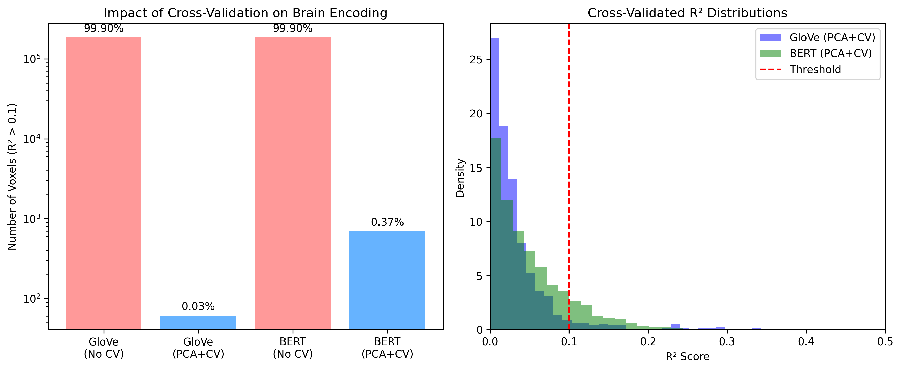
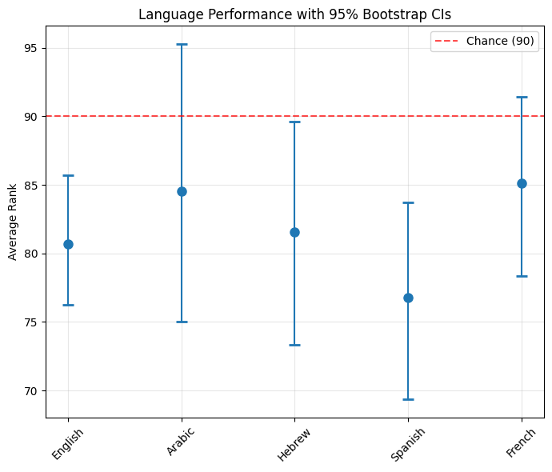

# Word Embeddings and the Brain

Course project for **00960222 – Language, Computation and Cognition** (Technion, Spring 2025).

The project builds on Pereira et al. (2018), *Toward a universal decoder of linguistic meaning from brain activation*, which showed that word embeddings can be decoded from fMRI data. It has two parts: structured tasks that extend the original analyses, and an open-ended analysis of cross-lingual decoding.

## Structured tasks

**Task 1 – Decoding with different embeddings.** Compared GloVe and Word2Vec decoders on the 180-concept dataset (mean rank 61.9 vs. 61.1, chance = 90), then tested the concept-trained decoder on the sentence datasets from Experiments 2 and 3 of the original paper (59.3% and 58.8% rank accuracy), including a breakdown by topic.

**Task 2 – Sentence representations.** Trained decoders directly on the 384 sentences from Experiment 2 using GloVe, BERT and Sentence-BERT representations. Sentence-BERT performed best (97.0%), followed by BERT (88.3%) and GloVe (78.6%).

**Task 3 – Brain encoding.** Reversed the direction and predicted voxel activity from sentence embeddings with a separate linear regression per voxel. Without validation, the models appeared to predict almost every voxel, which turned out to be overfitting (more embedding dimensions than sentences). With PCA and 5-fold cross-validation, 61 voxels were predictable from GloVe and 693 from BERT (R² > 0.1).



## Open-ended task: cross-lingual decoding

Tested whether a decoder trained on English fMRI data transfers to other languages via multilingual BERT embeddings.

- The 180 concepts were translated into Arabic, Hebrew, Spanish and French (GPT-4, with manual verification of the Arabic and Hebrew).
- Decoders were trained on English fMRI–mBERT pairs and tested on the target-language mBERT embeddings without retraining (ridge regression, 18-fold cross-validation).
- Significance was assessed with permutation tests and bootstrap confidence intervals.

All four languages had mean ranks better than chance (76.8–85.1, chance = 90; English baseline 80.7). However, the 95% bootstrap confidence intervals for Arabic and French include chance level, and the intervals of all languages overlap, so neither the transfer for those two languages nor the differences between languages are statistically robust. Arabic showed the highest variance across folds.



Since the fMRI data comes only from English speakers, this setup mainly tests how well mBERT's cross-lingual alignment supports transfer, not whether the brain represents concepts the same way across languages. Testing that would require fMRI data from speakers of the other languages.

## Repository structure

| File | Contents |
|---|---|
| `project.ipynb` | Structured tasks 1–3 |
| `open_task.ipynb` | Cross-lingual decoding analysis |
| `learn_decoder.py`, `decoder_utils.py` | Decoder training and evaluation |
| `word2vec_utils.py` | Word2Vec embedding helpers |
| `pset3_functions.py` | Helper functions from the course homework |
| `download_files.py` | Downloads the data files |

## Running

```bash
pip install -r requirements.txt
python download_files.py
```

Then run the notebooks.

## Data

fMRI data from Pereira et al. (2018), as provided in the course.

## Reference

Pereira, F., Lou, B., Pritchett, B., Ritter, S., Gershman, S. J., Kanwisher, N., Botvinick, M., & Fedorenko, E. (2018). Toward a universal decoder of linguistic meaning from brain activation. *Nature Communications*, 9(1), 963.
